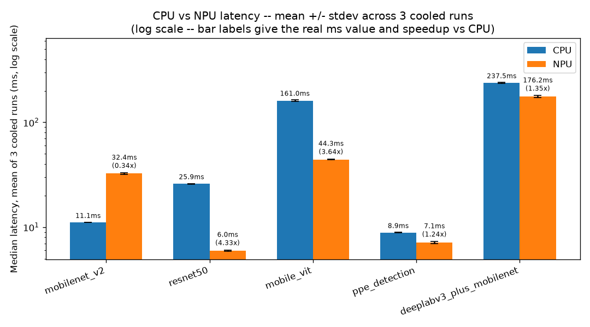
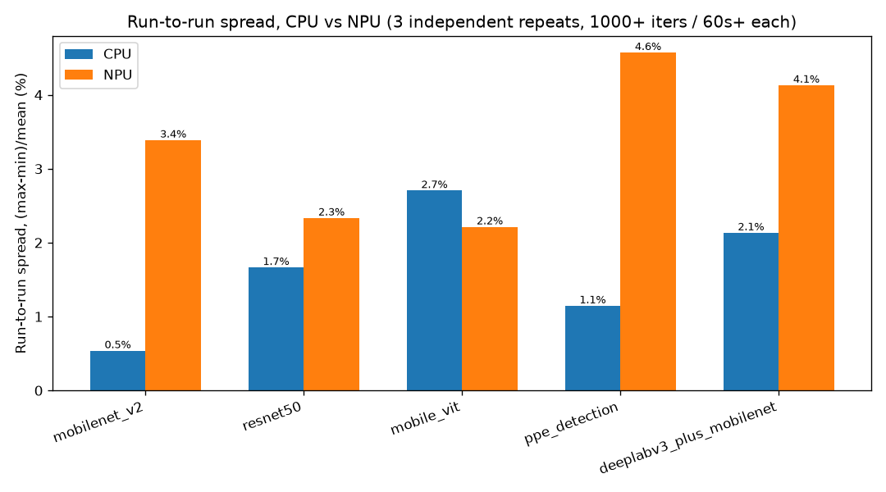
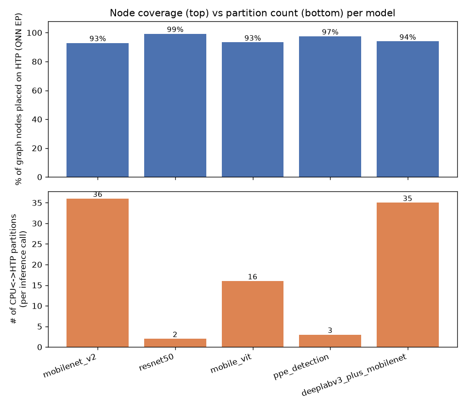
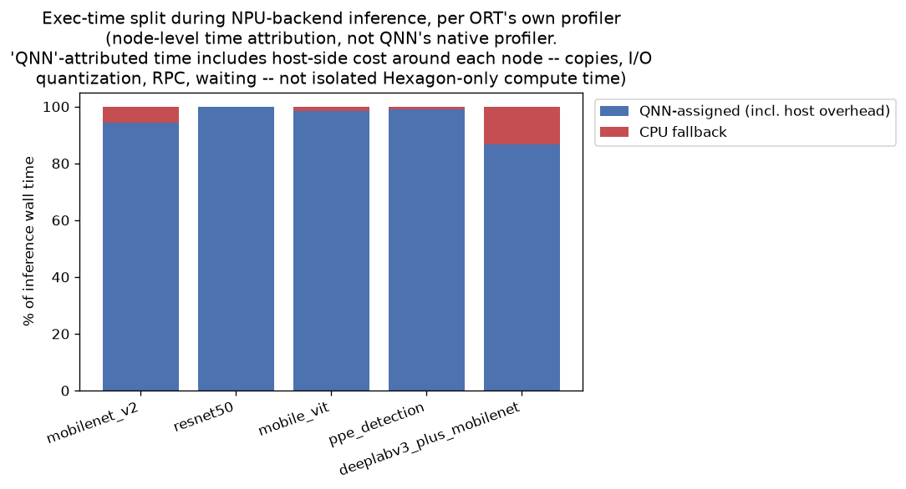
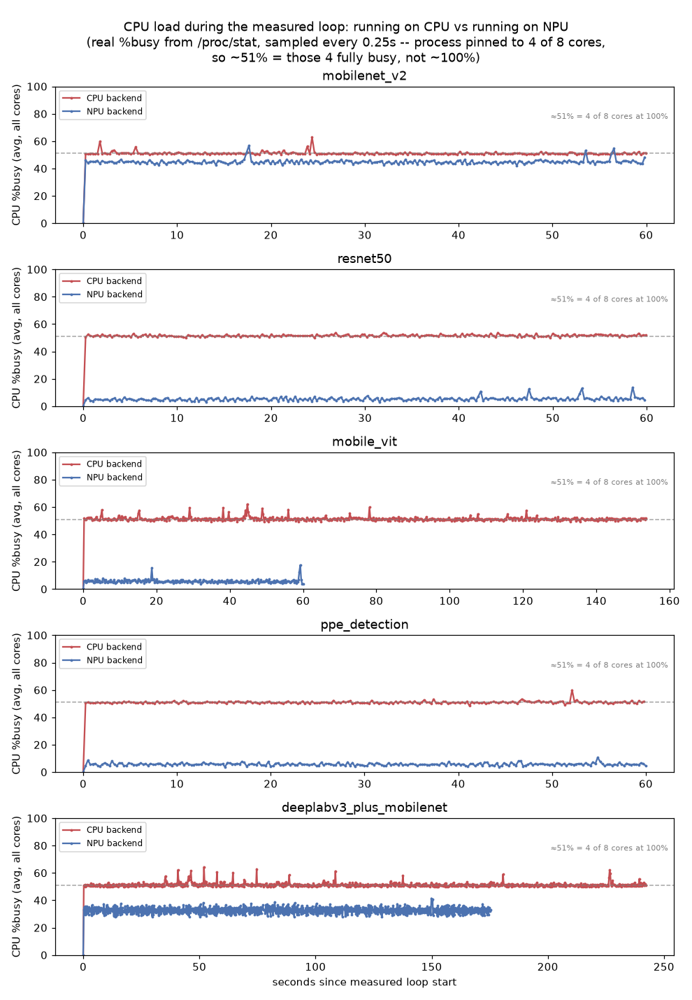
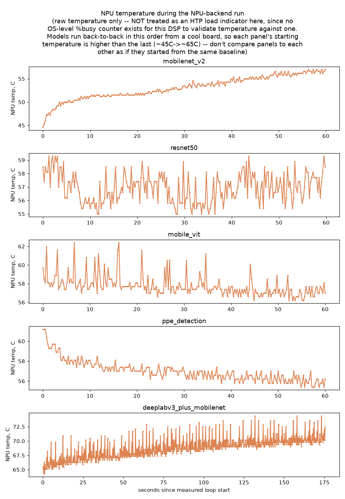

# Results 

Board: Thundercomm Rubik Pi 3, Qualcomm QCS6490, Qualcomm Linux 1.5-ver.1.1,
kernel 6.6.90. Runtime: ONNX Runtime 1.23.0 + QNNExecutionProvider
(`/usr/lib/libQnnHtp.so` for NPU, default `CPUExecutionProvider` for CPU).
20 warmup runs, then a minimum of 1000 measured runs AND 60s of wall time
(whichever needs more iterations -- see Key Finding #7), batch=1,
identical input per model across all backends, process pinned to the 4
A78 ("big") cores with 4 intra-op threads -- single stream (one request
at a time, no concurrent/batched requests), not single thread: on the CPU
backend, 4 ONNX Runtime worker threads actually run per inference; on the
NPU backend, that same 4-thread pool exists and runs whatever nodes fall
back to CPU -- CPU load during NPU runs is not negligible, though, see
finding #2 (inference-only, no pre/postprocessing in the timed loop --
see `end_to_end_ms` for the one full-pipeline number). See `README.md`
for the full measurement methodology and `RUNBOOK.md` for exact
reproduction commands.

Two datasets:
- **Uncooled** (`results/`): 1 run, 5 models x {cpu, npu} = 10 combos
  back-to-back, no confirmed active cooling. Includes per-run CPU %busy
  timeseries (`results/raw/*.json`, charted in `cpu_load_timeseries.png`)
  and an NPU-vs-CPU exec-time split per model, per ORT's own profiler
  (`exec_time_split.png` -- see Key Finding #2 for what that time split
  does and doesn't capture).
- **Cooled** (`results_cooled_run1/2/3/`): 3 independent full repeats,
  fan manually driven at full PWM duty (board's fan is not bound to any
  kernel thermal trip point -- see `scripts/run_all_cooled.sh`), fixed
  240s pause between every run instead of back-to-back.

## Main table: uncooled (current) vs cooled (mean +/- stdev of 3 runs)

| Model | Backend | Uncooled median (ms) | Cooled mean (ms) | Cooled stdev | Spread (3 runs) | Speedup vs CPU (cooled-mean) | Partitions | NPU/CPU exec-time split (ORT profiler attribution) | QNN nodes on NPU | Sanity | FP32 compare |
|---|---|---|---|---|---|---|---|---|---|---|---|
| mobilenet_v2 | cpu | 11.3231 | 11.10 | 0.03 | 0.5% | baseline | - | CPU=100.0% | n/a | True | {"cosine_sim": 0.9607, "top1_match": true} |
| mobilenet_v2 | npu | 32.8347 | 32.43 | 0.57 | 3.4% | 0.34x | 36 | QNN=94.3%  CPU=5.7% | 459/494 | True | {"cosine_sim": 0.9596, "top1_match": true} |
| resnet50 | cpu | 25.0017 | 25.90 | 0.22 | 1.7% | baseline | - | CPU=100.0% | n/a | True | {"cosine_sim": 0.9968, "top1_match": true} |
| resnet50 | npu | 5.9116 | 5.98 | 0.07 | 2.3% | 4.33x | 2 | QNN=99.8%  CPU=0.2% | 403/406 | True | {"cosine_sim": 0.9972, "top1_match": true} |
| mobile_vit | cpu | 154.3011 | 160.96 | 2.40 | 2.7% | baseline | - | CPU=100.0% | n/a | True | {"cosine_sim": 0.9997, "top1_match": true} |
| mobile_vit | npu | 43.1789 | 44.26 | 0.49 | 2.2% | 3.64x | 16 | QNN=98.5%  CPU=1.5% | 1374/1473 | True | {"cosine_sim": 0.9937, "top1_match": true} |
| ppe_detection | cpu | 9.4174 | 8.86 | 0.06 | 1.1% | baseline | - | CPU=100.0% | n/a | True | {"cosine_sim": {"boxes": 0.9923, "scores": 0.9121}, "top1_match": true} |
| ppe_detection | npu | 7.2121 | 7.14 | 0.16 | 4.6% | 1.24x | 3 | QNN=99.1%  CPU=0.9% | 701/719 | True | {"cosine_sim": {"boxes": 0.9923, "scores": 0.9045}, "top1_match": true} |
| deeplabv3_plus_mobilenet | cpu | 242.3165 | 237.53 | 2.56 | 2.1% | baseline | - | CPU=100.0% | n/a | True | {"pixel_agreement_pct": 99.54} |
| deeplabv3_plus_mobilenet | npu | 175.2889 | 176.25 | 3.72 | 4.1% | 1.35x | 35 | QNN=86.7%  CPU=13.3% | 527/561 | True | {"pixel_agreement_pct": 99.56} |

## Charts

## Key findings

1. **No model ran 100% on the NPU.** QNN EP always split the graph into 2-36 partitions (CPU/HTP handoffs inside one inference call) -- resnet50 the fewest (2), mobilenet_v2 the most (36). Partition count does **not** cleanly predict the size of the NPU-vs-CPU speedup by itself, though: rank correlation between partition count and this project's own NPU-vs-CPU speedup across the 5 models is -0.7 (Spearman, n=5 -- not a significant result at this sample size, read as descriptive, not proof). mobilenet_v2 (36 partitions) ends up *slower* on NPU than CPU (0.34x) while deeplabv3_plus_mobilenet (almost as many partitions, 35) still comes out ahead (1.35x) -- partition count alone doesn't explain that difference. An internal, self-contained fact from the table above does, at least partly: mobilenet_v2's QNN-assigned nodes alone (excluding CPU-fallback time) cost about 30.6ms -- 2.8x the *entire* CPU-backend run (11.1ms) -- while deeplabv3_plus_mobilenet's QNN-assigned time alone is about 153ms against a 237.5ms CPU run. Why 36 QNN calls cost this much on a small, fast model is not isolated here; a roughly fixed per-call cost that a short model can't amortize (but a long one can) is the obvious candidate, and per-partition timing from ORT's profiler (`enable_profiling`, per-node `dur` grouped by partition boundary) would test it directly -- not done in this project.

2. **"CPU %busy" and "CPU-attributed exec time" are two different measurements, and they disagree for mobilenet_v2 -- that disagreement is itself informative.** Real CPU %busy (from `/proc/stat`, system-wide average across all 8 cores -- the process is pinned to 4 of them, so the CPU-backend baseline reads ~51% here, not ~100%, because the 4 idle cores pull the 8-core average down) during each NPU-backend run: mobilenet_v2 (36 partitions) sits at 45% CPU busy, close to the CPU-backend baseline itself, while deeplabv3_plus_mobilenet (35 partitions) sits at 33% -- elevated, but only about 64% of the CPU-backend baseline, not "close" to it. Partition count alone does not predict this, though: mobile_vit (16 partitions) sits at only 5.8% CPU busy, about the same as resnet50 (2 partitions) at 5.2% and ppe_detection (3 partitions) at 5.7% -- 16 partitions and 2 partitions landing at roughly the same CPU load. These system-wide %busy figures also don't match ORT's own per-node exec-time attribution: mobilenet_v2/npu attributes 94.3% of wall time to QNN-assigned nodes and only 5.7% to CPU-assigned nodes, yet the CPU is measurably busy 45% of the time during that same run. The likely reconciliation: CPU %busy counts *everything* the CPU does, including host-side cost around QNN-assigned nodes (buffer copies, I/O quantization, RPC calls to the DSP, waiting) that ORT's profiler still attributes to the QNN provider rather than to CPU -- the two numbers are measuring different things, not contradicting each other. Not isolated here: how much of that CPU time is useful work (copies, quantization) vs. ONNX Runtime's own intra-op thread pool spin-waiting on an idle worker thread while the HTP call is in flight -- not measured separately from the rest of CPU %busy in this project. See `cpu_load_timeseries.png` and `exec_time_split.png`.
3. **"Spread" here means (max-min)/mean of the median latency across the 3 cooled repeats -- a relative, run-to-run number, not a per-call jitter number (this project does not measure per-call jitter; "stdev" in the table is the same run-to-run quantity, just expressed as a standard deviation instead of a range).** By that measure NPU spread is higher than CPU spread in 4 of 5 models, but at only 3 repeats per model that is not a statistically strong result -- read it as a direction, not a settled conclusion. CPU spread ranges 0.5-2.7%, NPU spread ranges 2.2-4.6%. The run-to-run stdev (also in the table, in ms -- sample stdev, n-1 denominator, i.e. `statistics.stdev()`, not the population variant) is not a fixed amount across models -- as a coefficient of variation (stdev/mean) it ranges 0.3-2.3% across all 10 model/backend rows, roughly scaling with each model's own latency rather than being one constant number in ms. At only 3 repeats per model, a specific growth-rate multiplier between any two individual models' stdevs is not estimated precisely enough to claim -- this finding stops at "scales with latency," not a specific ratio. **A single run is not representative of either backend -- this is the concrete reason this project runs 3 independent repeats instead of 1** (see finding #7 for how spread changed after increasing iteration count/duration).
4. **Commanded-fan runs' effect on peak temperature was mixed in this dataset, and the uncooled-vs-cooled latency gap behaves differently on CPU than on NPU.** Peak CPU temp deltas (uncooled minus cooled-mean) ranged from -17.7C to +10.9C across the 10 model/backend combos -- some runs were measurably *hotter* commanded-cooled than uncooled, not lower. The likely confound is run order: the uncooled sequence runs each model once from a freshly-booted, cool board, while the cooled sequence runs the same 10 combos back-to-back (with 240s pauses) in one long cycle, so heat can still accumulate across the whole cycle regardless of the fan. **On latency, the uncooled-vs-cooled-mean gap stays inside the 3-run spread for 4 of 5 NPU rows (-2.4% to +1.3%, mobile_vit the one exception) but EXCEEDS the 3-run spread for 4 of 5 CPU rows** (mobilenet_v2: +2.0% vs 0.5% spread, resnet50: -3.5% vs 1.7% spread, mobile_vit: -4.1% vs 2.7% spread, ppe_detection: +6.2% vs 1.1% spread, deeplabv3_plus_mobilenet: +2.0% vs 2.1% spread) -- CPU deviates noticeably more than NPU here, even though neither is a clean 100%. Signs flip model to model (not a consistent 'cooling helps' or 'cooling hurts' direction), so this looks like a session-to-session or run-order effect distinct from both the cooling condition and the within-session run-to-run noise characterized in finding #3, not evidence that cooling itself changed CPU speed. Practical effect: treat any single-run speedup figure as having roughly 6% additional uncertainty beyond the cooled-mean's own spread -- e.g. ppe_detection's cooled-mean speedup is 1.24x, but the uncooled-single-run speedup for the same model was 1.31x. Per-sample big-core frequency: across all 36180 (core, sample) readings from the 20 CPU-backend runs (5 models x 4 datasets), only 1 fell below that core's own rated max -- the big cores ran at their individual rated clocks (4:2.4GHz, 5:2.4GHz, 6:2.4GHz, 7:2.7GHz) for essentially the entire duration of every CPU-backend run, cooled or not, up to the highest recorded peak of 98.1C -- the strongest evidence against thermal throttling on this board, since CPU-backend is the condition that actually sustains full big-core load for the whole run. NPU-backend frequency ranged 1.766-2.707GHz, tracking CPU load (finding #2) rather than CPU-fallback-node time specifically (the two differ, see finding #2) -- low for the models with low CPU %busy, high for mobilenet_v2/deeplab -- read as ordinary load-based governor scaling, not throttling, though no A/B against `governor=performance` was run to confirm that directly. Also unverified: whether the fan was actually spinning during "cooled" runs -- this board's `hwmon30` has no tachometer (`fan1_input`), only the commanded PWM value (see Limitations).
5. **Detection model had to be swapped.** `qualcomm/Yolo-X` loads fine
   but QNN HTP refuses to compile its graph at all (`Failed to finalize
   QNN graph`, error 1002) -- a hard failure, not a fallback. Replaced
   with `qualcomm/PPE-Detection`, which compiles cleanly.
6. **Sanity check passed on every single CPU and NPU run** across every
   dataset in this project (uncooled + all 3 cooled repeats). This is a
   one-image wiring check (right breed name / plausible detection /
   plausible mask on one fixed image), not an accuracy measurement -- see
   `fp32_compare` in the table (cosine similarity / top-1 agreement
   against a FP32 reference on that same image) and the Limitations below.
7. **1000+ iterations and 60s+ wall time (vs. an earlier 200-iteration pass) is consistent with tighter run-to-run spread, though iteration count wasn't the only thing that changed.** NPU spread across 3 repeats is now 2.2-4.6% (was ~10% on fast models with only 200 iterations) -- consistent with most of that earlier spread being a sampling artifact rather than pure hardware jitter, but CPU-affinity pinning and the cooled-run setup were also introduced between the two passes, so iteration count is not isolated as the sole cause. `bench.py`'s loop now runs until BOTH a minimum of `--iters` (1000) AND `--min-duration-s` (60) have elapsed, whichever needs more, with the thermal/CPU%busy sampler running every 0.25s throughout.

## Limitations

- **Untuned defaults.** QNN EP is constructed with only `backend_path` set
  (see `scripts/bench.py`) -- no other provider option is passed anywhere
  in this project. `htp_performance_mode` is left at the QNN EP default
  (not `burst`), `htp_graph_finalization_optimization_mode` is left at
  its default (0), `enable_htp_shared_memory_allocator` is left at its
  default (0), and no EP context cache is enabled (the session option is
  `ep.context_enable`, not something set here). These are out-of-the-box
  numbers for ONNX Runtime 1.23.0 + `libQnnHtp.so` (QAIRT 2.35.0), not
  best-achievable ones -- the ranking in finding #1, especially
  mobilenet_v2's result, may change with `burst` mode, a different
  finalization-optimization level, the shared-memory allocator, or a
  newer QAIRT/ORT build. None of these were tested in this project. An EP
  context cache would only cut session-creation time, not per-inference
  latency -- it does not belong on this list as a lever for ranking.
- **Energy / power draw not measured** (no USB-C power meter).
- **No OS-level NPU %busy exists.** The Hexagon DSP has no sysfs/debugfs
  busy/load counter on this board, and QNN's own post-hoc op-timing
  profiler (`qnn-profile-viewer`) cannot decode this board's profiling
  logs -- the installed `libQnnHtp.so` is built from QAIRT 2.35.0, the
  only `qnn-profile-viewer` available is from the separately staged QAIRT
  2.40.0 SDK, and the log's binary flatbuffer format isn't compatible
  across that gap ("Corrupted flatbuffer binary stream"). Worked around
  with ONNX Runtime's own built-in profiler instead (finding #2) -- a
  per-run time split attributed by ORT's own node-level accounting (not
  isolated Hexagon-only time, see finding #2), and not a continuously live
  gauge (the split is a property of the model+backend, it doesn't
  fluctuate like CPU load does).
- **"Cooled" means PWM commanded to full duty + 240s pauses, not confirmed
  airflow.** The board's PWM fan is not kernel-thermal-governed, so it was
  driven manually (`echo 255 > /sys/class/hwmon/hwmon30/pwm1`) before the
  cooled runs. `hwmon30` exposes `pwm1`/`pwm1_enable` (confirmed set to
  255/1) but no tachometer (`fan1_input` does not exist on this board), so
  there is no sensor-based way to confirm the fan was actually spinning --
  only the commanded PWM value, not verified airflow. See finding #4 for
  what the resulting temperature data actually looked like (mixed, not a
  clean reduction).
- **Cooldown between cooled runs is a fixed 240s pause**, not a
  temperature-threshold wait -- idle CPU temp plateaued at ~50-55C
  regardless of the fan and did not keep dropping with more wait time, so
  a threshold-based wait was dropped as a dead end for this board/ambient
  combination.
- **Still only 1 uncooled run** (3 repeats exist only for the cooled
  condition) -- given finding #3, the single uncooled NPU numbers should
  be read as having roughly the same 2.2-4.6%
  run-to-run uncertainty the cooled repeats exposed, not as exact figures.
  In this dataset the uncooled run was collected first, immediately after
  a fresh reboot (the coolest the board was at any point in the session),
  then the 3 cooled repeats ran afterward -- so the uncooled numbers start
  from a cooler baseline than any of the cooled repeats after the first
  one, which is itself a possible confound (see finding #4).
- **Preprocessing is a plain resize** (no letterbox/center-crop) for all
  models, to keep one identical pipeline across classification/detection/
  segmentation. Fine for latency/throughput and the pass/fail sanity
  check used here, but would understate real accuracy (mAP/mIoU) for the
  detection and segmentation models.
- **Detection sanity check is single-best-box only** (highest-score
  anchor), not full NMS -- enough to prove the pipeline is wired
  correctly, not a real detection-quality metric.
- **`fp32_compare` is a one-image numerical sanity check, not a real
  accuracy evaluation.** Cosine similarity / top-1 agreement between the
  backend-under-test's (dequantized) output and a FP32 reference run of
  the same model on CPU, on the same one test image. It tells you whether
  quantization grossly changed the output on this one input -- it is NOT
  top-1/top-5 on ImageNet val, mAP on COCO, or mIoU on VOC, which would
  need a labeled validation set (500-1000 images) this project does not
  have. If one number matters for a real accuracy claim, it's not this one.
- **`fps` = 1000/mean_ms is single-stream sequential throughput** (what
  you get calling `sess.run()` back-to-back, batch=1, one request at a
  time) -- not a measure of maximum achievable throughput under batching
  or concurrent streams, which this project does not test. `end_to_end_ms` adds
  preprocess+postprocess (each measured once, not per iteration, since
  the same preprocessed input is reused every iteration) on top of the
  inference-only median, for the one full-pipeline number.
